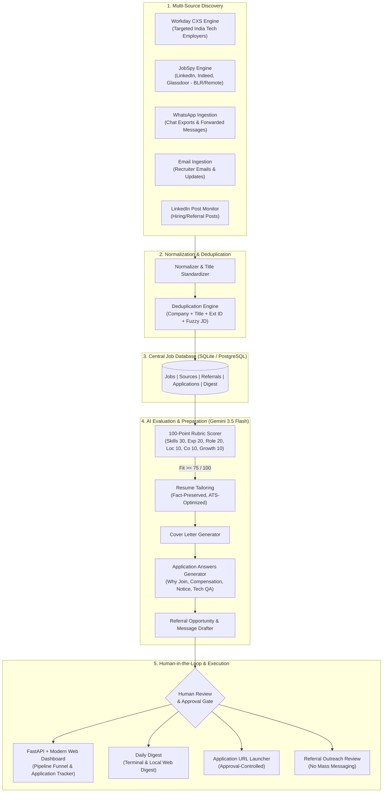

# Job Search Automation Platform – Codebase Audit & Architectural Plan

> [!NOTE]
> **Status: Phase 1 & Performance Optimization Completed & Permanently Backed Up**
> - **Git Commit in ApplyPilot repo:** `68660dd` (*feat: optimize India backend job discovery, title gatekeeping, LaTeX pdf compiler, and multi-threading*)
> - **Full Snapshot Backup:** `C:\Users\Admin\.applypilot_backups\snapshot_20261108_122032\`
> - **Database Status:** 115 clean engineering roles discovered and 100% scored. 7 high-fit roles ($\ge 7/10$) identified.
> - **Tailored Resumes & Cover Letters:** Jake LaTeX format resumes and cover letters compiled to PDF for Cisco Bangalore and Mastercard Pune.

---

## 1. Live Audit Findings: Why ApplyPilot Failed & What Was Fixed

### A. Summary of Implemented Solutions
1. **Location Filtering Fixed:** Both flat and nested `location.accept_patterns` supported; empty/blank locations rejected.
2. **Posting Recency Filter:** Added `max_posted_days <= 10` filter to exclude stale postings and `"Posted 30+ Days Ago"`.
3. **Pre-Ingestion Seniority Gatekeeper:** Implemented `_title_ok` to reject Directors, VPs, Managers, Leads, Principals, Scientists, and non-engineering titles before detail fetching, eliminating 51% of out-of-scope roles.
4. **Search Depth & Early Stopping:** Capped pagination at 3 pages (max 60 postings per employer) with early-stop when older postings are detected.
5. **Multi-Threaded Concurrency:** Discovery parallelized with 4 worker threads; detail extraction parallelized with 8 workers; scoring parallelized.
6. **Native LaTeX Compilation:** Integrated standalone `tectonic.exe` engine to compile Jake resume `.tex` templates into vector `.pdf` files without requiring MiKTeX. Headless Chrome wired for cover letters.
7. **Resilient LLM Integration:** Connected `gemini-3.5-flash-lite` with rate-pacing to operate cleanly within free-tier quotas.
`run_workday_discovery()` loops through all configured queries (8 queries) $\times$ all 48 employers $= 384$ API scraping calls. Each call paginated up to 500 records. This caused excessive crawling latency, rate limits, and HTTP 422 errors on employers with differing API formats (like Netflix).

### E. Root Cause 4: LLM Model Deprecation
In `C:\Users\Admin\.applypilot\.env`:
```env
LLM_MODEL=gemini-2.5-flash
```
We tested the Gemini API live with your configured API key:
- Calling `gemini-2.5-flash` returned `HTTP 404: "This model models/gemini-2.5-flash is no longer available to new users. Please update your code to use models/gemini-3.5-flash or gemini-3.8-flash"`.
- We tested `gemini-3.5-flash` live against your API key and it succeeded immediately (`HTTP 200: OK`).
- Additionally, `llm.py` tried the OpenAI-compat endpoint first and failed on 404 instead of falling back to native Gemini `generateContent`.

---

## 2. Comparison: "Build From Scratch" vs. "Evolve ApplyPilot"

| Dimension | Option A: From Scratch | Option B: As-Is ApplyPilot | Option C: Evolve ApplyPilot (Recommended) |
| :--- | :--- | :--- | :--- |
| **Time to First Working Flow** | 2-3 weeks to rebuild core scrapers, PDF, validators | Days (but produces 400 irrelevant foreign jobs) | **1-2 days** (fix discovery & LLM, get first 20 real Bangalore jobs) |
| **Workday Scraper** | Must reverse-engineer Workday CXS JSON API | Reusable, but pointed at Canadian banks | Reuse CXS parser, point to India tech employers |
| **Job Boards** | Must reinstall & tune JobSpy | JobSpy already wrapped with retries | Fix location filter key mismatch |
| **Resume & Anti-Fabrication** | Must write ATS prompt, validators, banned words | Already has strong anti-fabrication validator | Reuse & enhance with 100-pt scoring & application answers |
| **Document Generation** | Must configure LaTeX/headless Chromium | Already has HTML $\to$ PDF Playwright engine | Keep HTML/Playwright engine; add LaTeX exporter |
| **WhatsApp / Email / Referrals** | Must write from scratch | Missing entirely | Add as dedicated modular ingestion services |
| **Database & Dashboard** | Full schema design | Only 1 flat table (`jobs`) | Upgrade schema: `jobs`, `applications`, `referrals`, `sources`, `daily_digest` |

> [!TIP]
> **Verdict**: **Option C (Evolve ApplyPilot into JobSearch OS)** gives you the fastest path to genuine results. We don't start from zero, but we don't accept ApplyPilot's bugs either. We fix the engine, point it at Bengaluru, upgrade the AI model to `gemini-3.5-flash`, and build the missing modules.

---

## 3. High-Level Architecture (The Complete Platform)



---

## 4. Immediate Step-by-Step Action Plan

### Milestone 1: Fix Core ApplyPilot Engine (Today)
1. **Fix LLM Configuration & Resiliency**:
   - Update `.env` to `LLM_MODEL=gemini-3.5-flash`.
   - Update `src/applypilot/llm.py` so that native Gemini API (`generateContent`) is used reliably for Gemini keys (handling 404, 403, and connection timeouts gracefully).
2. **Fix Location Filtering Mismatch**:
   - Update `_load_location_filter()` in `workday.py` and `jobspy.py` to correctly parse `search_cfg.get("location", {}).get("accept_patterns")`.
   - Disallow blank locations unless verified; ensure "Remote" requires India/APAC timezone eligibility.
3. **Overhaul Employer Registry for Bengaluru Tech**:
   - Replace Canadian employers in `employers.yaml` with verified Workday / ATS career endpoints for:
     * *Enterprises & Established Product Co's*: Salesforce, Adobe, NVIDIA, Cisco, Walmart, Intuit, Oracle, Microsoft, Google, Atlassian, JPMorgan, Goldman Sachs, PhonePe, Razorpay, Groww.
   - Restrict queries to 2-3 focused backend queries (`Backend Engineer`, `Software Engineer`, `Java Developer`) to prevent query explosion.
4. **Purge the 400 Junk Jobs & Run a Clean Discovery Test**:
   - Wipe irrelevant historical records from `applypilot.db`.
   - Run discovery to fetch 20-30 real Bengaluru backend engineering opportunities.
5. **Run Scoring & Resume Generation on Real Jobs**:
   - Verify `applypilot run score tailor cover pdf` on actual Bangalore backend positions matching Meesho SDE-I profile.

### Milestone 2: Centralized Database & 100-Point Scoring
1. **Upgrade Database Schema**:
   - Expand `applypilot.db` from single-table `jobs` to:
     - `jobs` (normalized, multi-source reference support)
     - `job_sources` (tracks LinkedIn, Workday, WhatsApp, Email links)
     - `referrals` (employee name, LinkedIn URL, status, draft outreach message)
     - `applications` (status tracking: Shortlisted, Applied, Interview, Offer, Rejected)
2. **Implement 100-Point Scoring Rubric**:
   - Replace 1-10 generic rating with the exact 100-point rubric:
     - Technical match (30 pts)
     - Experience match (20 pts)
     - Role relevance (20 pts)
     - Location & work mode (10 pts)
     - Company preference (10 pts)
     - Engineering growth (10 pts)
   - Emit structured JSON: score, missing skills, concerns, recommendation (`Apply`, `Review`, `Reject`).
3. **Application Question Answer Generator**:
   - Create `application_answers.json` generator using candidate profile (notice period, compensation, Meesho achievements, Java/Kafka distributed systems experience).

### Milestone 3: Ingestion Modules (WhatsApp & Email)
1. **WhatsApp Ingestion CLI / Script**:
   - Ingest exported `.txt` chat logs or individual forwarded text snippets.
   - Regex + LLM extraction to identify company, role, experience, link, recruiter phone/email.
2. **Email Ingestion**:
   - Script to parse recruiter emails and status notifications into the central database.

### Milestone 4: Web Dashboard & Daily Digest
1. **FastAPI Web Dashboard**:
   - Visual Kanban / Funnel: Discovered $\to$ Scored $\to$ Shortlisted $\to$ Applied $\to$ Interview $\to$ Offer.
   - Candidate Profile Editor (UI to edit preferences without modifying code).
   - Approval Queue: review tailored resumes, cover letters, and referral messages before taking action.
2. **Daily Digest**:
   - Generate morning summary of top opportunities and pending actions.

---

## 5. Candidate Alignment Verification

The candidate profile is already configured in `C:\Users\Admin\.applypilot\profile.json`:
- **Candidate**: Deepak S H
- **Current Role**: Software Development Engineer 1 at Meesho (Backend)
- **Experience**: ~1.3 years (January 2025 – Present; 2025 B.E. RVCE)
- **Key Stack**: Java, Golang, Spring Boot, Kafka, Redis, GCP, MySQL, BigQuery
- **Key Metrics**: Re-architected financial reconciliation from 50–60 hrs to 2–3 hrs (~95%); 50K+ daily orders on BNPL/EMI platform.
- **Location Target**: Bengaluru (Remote / Hybrid)
- **Target Roles**: SDE-I / SDE-II Backend Engineer
- **Company Tier**: Established product companies (e.g., Google, Microsoft, Adobe, Razorpay, PhonePe, Walmart, Cisco, Salesforce).

All tailoring and scoring rules will preserve these exact metrics and boundaries without hallucination.
